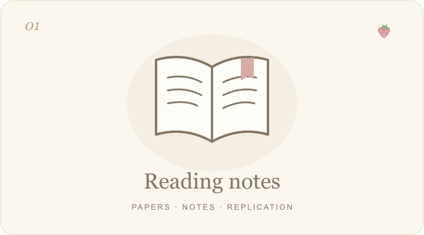
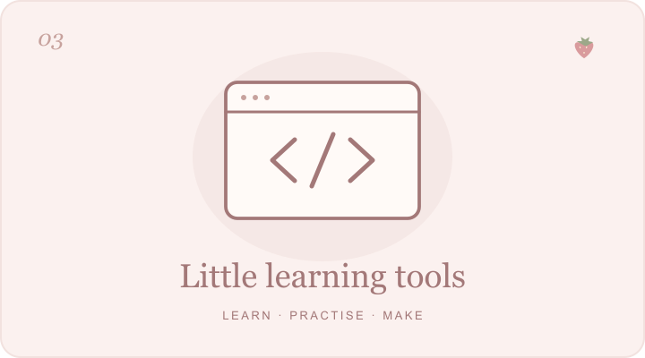

  

  <b>在阅读里积累，在问题里生长。</b> 
  <picture>
    <source media="(prefers-color-scheme: dark)" srcset="./reading-typewriter-dark.gif" />
    
  </picture>

  <a href="https://github.com/Zhihan-iris/literature-reading">Reading</a>
  &nbsp; · &nbsp;
  <a href="https://github.com/Zhihan-iris/causal-inference">Research</a>
  &nbsp; · &nbsp;
  <a href="https://github.com/Zhihan-iris/learning-websites">Little projects</a>

 

### A little about me

你好，我是 **Zhihan**。欢迎来到我的小小学习角落。

这里放着我的文献阅读、因果推断学习，以及慢慢做出来的小项目。喜欢把复杂的问题拆开理解，再把零散的想法整理成可以回看的记录。

> A place for questions, notes, and small discoveries.

  
  
  
  

 

### On my desk

<table>
  <tr>
    <td width="33%" valign="top">
      
      <h3>文献阅读手记</h3>
      
经济学论文、阅读讲义，以及从问题走向复现的记录。

      <a href="https://zhihan-iris.github.io/literature-reading/">翻开笔记 ↗</a>
      &nbsp; · &nbsp;
      <a href="https://github.com/Zhihan-iris/literature-reading">仓库</a>
    </td>
    <td width="33%" valign="top">
      
      <h3>因果推断学习室</h3>
      
从潜在结果到 DID、IV 与 RD，用中文讲义和互动实验理解识别。

      <a href="https://zhihan-iris.github.io/causal-inference/">进入学习室 ↗</a>
      &nbsp; · &nbsp;
      <a href="https://github.com/Zhihan-iris/causal-inference">仓库</a>
    </td>
    <td width="33%" valign="top">
      
      <h3>学习与小工具</h3>
      
把计量经济学、英语听力和写作，做成可以动手练习的网页。

      <a href="https://zhihan-iris.github.io/learning-websites/econometrics/">计量 ↗</a>
      &nbsp; · &nbsp;
      <a href="https://zhihan-iris.github.io/learning-websites/listening/">听力 ↗</a>
      &nbsp; · &nbsp;
      <a href="https://zhihan-iris.github.io/learning-websites/writing/">写作 ↗</a>
      
<a href="https://github.com/Zhihan-iris/learning-websites">查看仓库</a>

    </td>
  </tr>
</table>

 

### Lately · 最近在做

- **文献与复现**：整理[远程办公与城市结构](https://github.com/Zhihan-iris/literature-reading/tree/main/remote-work-city-structure)、[能源监管与企业集团](https://github.com/Zhihan-iris/literature-reading/tree/main/Regulating-Conglomerates)等论文的阅读和复现材料。
- **方法与直觉**：用[中文讲义与互动实验](https://zhihan-iris.github.io/causal-inference/)梳理因果推断，把假设、公式和例子串起来。
- **学习与实践**：把计量、听力和写作练习做成[小工具](https://github.com/Zhihan-iris/learning-websites)，让学习过程留下可回看的记录。

一点点阅读，一点点实践，也一点点把这里整理得更好。

 

  

  <i>A soft little corner for a curious mind.</i> 
  谢谢你来这里看看，愿你今天也有一点小小的发现。

