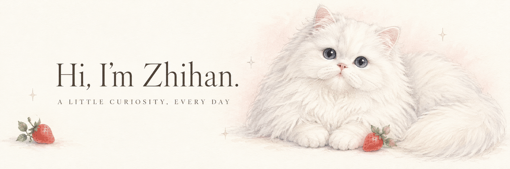

  

  <b>在阅读里积累，在问题里生长。</b> 
  <picture>
    <source media="(prefers-color-scheme: dark)" srcset="./reading-typewriter-dark.gif" />
    
  </picture>

  <a href="https://github.com/Zhihan-iris/literature-reading">Reading</a>
  &nbsp; · &nbsp;
  <a href="https://github.com/Zhihan-iris/causal-inference">Research</a>
  &nbsp; · &nbsp;
  <a href="https://github.com/Zhihan-iris/learning-websites">Little projects</a>

 

### A little about me

你好，我是 **Zhihan**。欢迎来到我的小小学习角落。

这里放着我的文献阅读、因果推断学习，以及慢慢做出来的小项目。喜欢把复杂的问题拆开理解，再把零散的想法整理成可以回看的记录。

> A place for questions, notes, and small discoveries.

 

### On my desk

<table>
  <tr>
    <td width="50%" valign="top">
      01 &nbsp; / &nbsp; READING NOTES
      <h3><a href="https://github.com/Zhihan-iris/literature-reading">文献阅读手记</a></h3>
      
读过的文章，留下的问题，以及一点点积累的理解。

      <a href="https://github.com/Zhihan-iris/literature-reading">Open the notebook ↗</a>
    </td>
    <td width="50%" valign="top">
      02 &nbsp; / &nbsp; CAUSAL INFERENCE
      <h3><a href="https://github.com/Zhihan-iris/causal-inference">因果推断学习</a></h3>
      
从“有没有关系”，继续追问“为什么”和“如何识别”。

      <a href="https://github.com/Zhihan-iris/causal-inference">Follow the questions ↗</a>
    </td>
  </tr>
</table>

  03 &nbsp; / &nbsp; LITTLE PROJECTS 
  <b><a href="https://github.com/Zhihan-iris/learning-websites">学习与小工具</a></b>
  &nbsp; — &nbsp; 把学习中的小想法，做成可以打开的小作品。

 

### Currently exploring

**Econometrics** &nbsp; · &nbsp; **Causal inference** &nbsp; · &nbsp; **Reproducible research**

用 Stata 和 Python 学习、实践，也认真对待每一个“为什么”。

 

  

  <i>A soft little corner for a curious mind.</i> 
  谢谢你来这里看看，愿你今天也有一点小小的发现。

