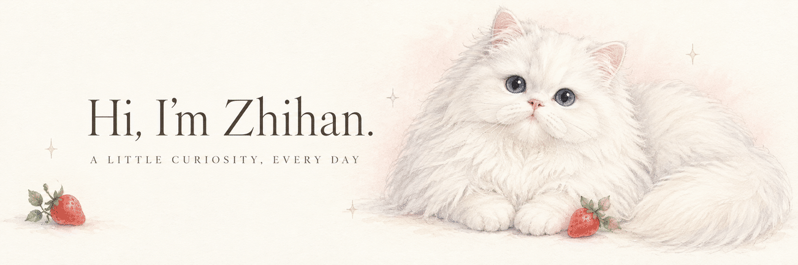
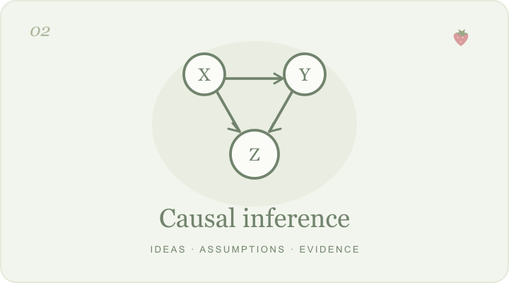

  

  <b>在阅读里积累，在问题里生长。</b> 
  <picture>
    <source media="(prefers-color-scheme: dark)" srcset="./assets/animations/reading-typewriter-dark.gif" />
    
  </picture>

  <a href="#about">关于我</a>
  &nbsp; · &nbsp;
  <a href="#projects">我的作品</a>
  &nbsp; · &nbsp;
  <a href="#lately">最近在做</a>
  &nbsp; · &nbsp;
  <a href="./REPOSITORIES.md">仓库导航</a>

 

### About · 关于我

你好，我是 **Zhihan**。在这里分享经济学文献阅读、因果推断笔记，以及为学习做的小工具。

喜欢追问“为什么”，也喜欢把想明白的事情留下来。

  <picture>
    <source media="(prefers-color-scheme: dark)" srcset="./assets/badges/badge-stata-dark.gif" />
    
  </picture>
  <picture>
    <source media="(prefers-color-scheme: dark)" srcset="./assets/badges/badge-python-dark.gif" />
    
  </picture>
  <picture>
    <source media="(prefers-color-scheme: dark)" srcset="./assets/badges/badge-econometrics-dark.gif" />
    
  </picture>
  <picture>
    <source media="(prefers-color-scheme: dark)" srcset="./assets/badges/badge-causal-inference-dark.gif" />
    
  </picture>

 

### Projects · 我的作品

<table>
  <tr>
    <td width="50%" valign="top">
      
      <h3>文献阅读手记</h3>
      
从论文中的一个问题，读到模型、证据与复现。

      

        <a href="https://zhihan-iris.github.io/literature-reading/">翻开笔记 ↗</a>
        &nbsp; · &nbsp;
        <a href="https://github.com/Zhihan-iris/literature-reading">查看仓库</a>
      

    </td>
    <td width="50%" valign="top">
      
      <h3>因果推断学习室</h3>
      
先建立直觉，再用中文讲义与互动实验理解因果识别。

      

        <a href="https://zhihan-iris.github.io/causal-inference/">进入学习室 ↗</a>
        &nbsp; · &nbsp;
        <a href="https://github.com/Zhihan-iris/causal-inference">查看仓库</a>
      

    </td>
  </tr>
</table>

 

<table>
  <tr>
    <td width="36%" valign="middle">
      
    </td>
    <td width="64%" valign="middle">
      <h3>学习与小工具</h3>
      
把计量、听力和写作，变成每天能动手做一点的小练习。

      

        <a href="https://zhihan-iris.github.io/learning-websites/econometrics/">计量 ↗</a>
        &nbsp; · &nbsp;
        <a href="https://zhihan-iris.github.io/learning-websites/listening/">听力 ↗</a>
        &nbsp; · &nbsp;
        <a href="https://zhihan-iris.github.io/learning-websites/writing/">写作 ↗</a>
      

      
<a href="https://github.com/Zhihan-iris/learning-websites">查看仓库</a>

    </td>
  </tr>
</table>

 

### Lately · 最近在做

- **读论文** — [远程办公与城市结构](https://github.com/Zhihan-iris/literature-reading/tree/main/remote-work-city-structure)、[能源监管与企业集团](https://github.com/Zhihan-iris/literature-reading/tree/main/Regulating-Conglomerates)。
- **理方法** — 把因果推断中的假设、公式和例子串起来。
- **做练习** — 完善计量与英语学习中的交互和反馈。

 

  

  <i>A soft little corner for a curious mind.</i> 
  谢谢你来这里看看，愿你今天也有一点小小的发现。

